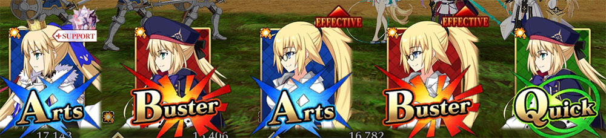

Card Priority tells FGA which face cards to pick after the NPs from the [command](Skill-Maker). It's optional; the default order is `WB, WA, WQ, B, A, Q, RB, RA, RQ`.

Open it with **Card Priority** in a [battle config](Battle).

## Card order

Drag the cards to reorder them. Cards at the top (HIGH) are picked before cards at the bottom (LOW).

| Symbol | Card |
|---|---|
| WB, WA, WQ | Buster, Arts, Quick that are effective against the enemy (weak) |
| B, A, Q | Normal Buster, Arts, Quick |
| RB, RA, RQ | Buster, Arts, Quick that the enemy resists |

Examples:

- Damage, Buster first:

  

- Charging NP, Arts first:

  

- Critical stars, Quick first:

  

## Waves

Wave 1 applies to the whole battle. Add waves (up to 3) with `+` only if you want a different priority in later waves.

Each wave has its own card order, [Brave Chains](#brave-chains) and [Rearrange Cards](#rearrange-cards) settings.

## Servant Priority

Turn on **Use Servant Priority** at the top to prefer the cards of some Servants over others. Servant Priority comes before card priority.

Then drag the team positions into the order you want. The positions are the same as in the [Skill Maker](Skill-Maker#positions).

## Brave Chains

- **Don't care:** pick cards only by priority.
- **With NP:** prefer cards of the Servant whose NP is used, to make a Brave Chain.
- **Avoid:** avoid Brave Chains.

## Rearrange Cards

In FGO, the position of a card changes its effect, and the first card gives a bonus to all three. For example, a Buster card first boosts the damage of all cards.

With Rearrange Cards, FGA plays the strongest card first and the 2nd strongest card last.
It only rearranges when at most one NP and no [cards before NP](Skill-Maker#noble-phantasms) are used that turn.

With the default card priority, FGA picks these 3 cards in this order:
1. Jeanne Archer Buster (strongest card)
2. Castoria Buster (3rd strongest card)
3. Jeanne Archer Arts (2nd strongest card)

Without Rearrange Cards, the Arts card would be 2nd and the Castoria card last.

## Face-card checks

Servant Priority, Brave Chains and [Shuffle cards](Battle#shuffle-cards) need to know which card belongs to which Servant. For this, FGA opens each Servant's details once when they enter the field, to see their face.
`Skip servant face-card checks` in [More Options](More-Options#battle) turns this off, but then those features don't work.
