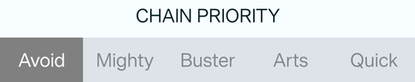
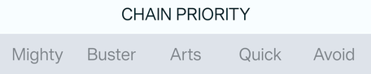
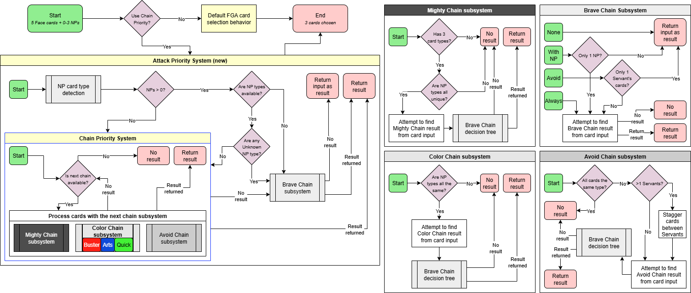
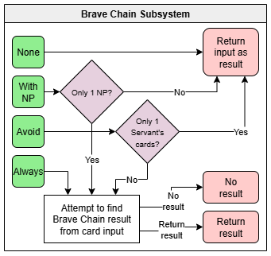
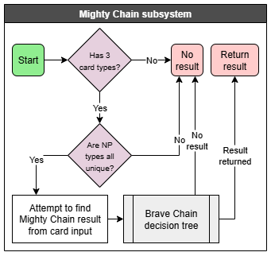
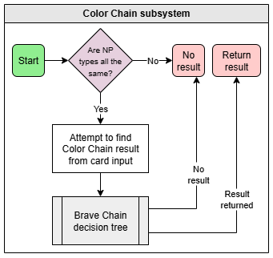
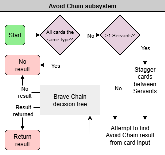

Card Priority tells FGA which face cards to pick after the NPs from the [command](Skill-Maker). It's optional; the default order is `WB, WA, WQ, B, A, Q, RB, RA, RQ`.

Open it with **Card Priority** in a [battle config](Battle).


## Card order

Drag the cards to reorder them. Cards at the top (HIGH) are picked before cards at the bottom (LOW).


| Symbol | Card |
|---|---|
| WB, WA, WQ | Buster, Arts, Quick that are effective against the enemy (weak) |
| B, A, Q | Normal Buster, Arts, Quick |
| RB, RA, RQ | Buster, Arts, Quick that the enemy resists |

Examples:

- Damage, Buster first:

  

- Charging NP, Arts first:

  

- Critical stars, Quick first:

  

## Waves

Wave 1 applies to the whole battle. Add waves (up to 3) with `+` only if you want a different priority in later waves.


Each wave has its own card order, [Brave Chains](#brave-chains) and [Rearrange Cards](#rearrange-cards) settings.

## Servant Priority

Turn on **Use Servant Priority** at the top to prefer the cards of some Servants over others. Servant Priority comes before card priority.


Then drag the team positions into the order you want. The positions are the same as in the [Skill Maker](Skill-Maker#positions).


## Chain Priority


Turn on **Use Chain Priority** at the top to enable Chain Priority. It allows for attempts at `Mighty`, $${\color{red}Buster}$$, $${\color{blue}Arts}$$ or $${\color{green}Quick}$$ Chains, based on the order that the chains are chosen in. There is an additional option called "Avoid", which when used attempts to avoid any of the other chains. 

| Sample orders                                                                       | Name                            | Description                                                                                                                                                                                                                          | 
|:------------------------------------------------------------------------------------|:--------------------------------|:-------------------------------------------------------------------------------------------------------------------------------------------------------------------------------------------------------------------------------------|
|  | Default order                   | The default order used when Chain Priority is turned on. This disables Avoid Chain.                                                                                                                                                  | 
|    | $${\color{red}Buster}$$ focused | This order disables all chains except $${\color{red}Buster}$$ (highest priority) and `Mighty` (second priority). Failure to execute any of these chains will result in no other chain being (actively) used.                         |
|        | $${\color{blue}Arts}$$ only     | Only $${\color{blue}Arts}$$ chains will be attempted. All other chain checks are skipped.                                                                                                                                            | 
|      | "Avoid" only                    | All chains will be avoided, unless it is absolutely impossible (e.g. all cards are $${\color{green}Quick}$$ cards).                                                                                                                  | 
|        | None                            | This completely skips all checks. It is almost the same as turning Chain Priority off, except that it uses Chain Priority's [Brave Chain](#brave-chains) handling instead of the default (which allows usage of the 'Always' option). |

The way Chain Priority works is that it checks for Chains in the order that is shown (from left to right). If it finds a chain, then it will use that chain immediately.

E.g. If Chain Priority is on and `Default order` is used, it will attempt to check for a `Mighty` Chain first. If there is no valid `Mighty` Chain, then it will attempt to check for a $${\color{red}Buster}$$ Chain. If there is no valid $${\color{red}Buster}$$ Chain, it will attempt to check for an $${\color{blue}Arts}$$ Chain and so on and so forth. If an $${\color{blue}Arts}$$ Chain was found, it will skip checking for a $${\color{green}Quick}$$ Chain using the cards and will immediately use the $${\color{blue}Arts}$$ Chain. However, if all options fail to find any usable Chain, it will fallback to Servant Priority + Card Priority to determine the cards used.   

|                         Flowchart of entire system                         | 
|:--------------------------------------------------------------------------:|
|  |

### Interaction with other priorities

In general, the priority of card handling is in this order:

```
Brave Chains > Chain Priority > Servant Priority (if on) > Card Priority 
```

This means that the [Brave Chain](#brave-chains) option is of the highest importance. This interaction with Chain Priority will be elaborated on in the corresponding sections.

|         Simplified Brave Chain flowchart / decision tree          | 
|:-----------------------------------------------------------------:|
|  |

Please refer to the [Brave Chain](#brave-chains) section for more information on what each Brave Chain option entails. 

### Mighty Chain

|                  Simplified Mighty Chain flowchart                  | 
|:-------------------------------------------------------------------:|
|  |

Mighty Chains, by definition, require all 3 card types in a single chain to be executed. Mighty Chains can be done with multiple Servants or with a single Servant (thus forming a Brave Chain). The order of Mighty Chain cards is currently determined using the [Card Priority](#card-order). Thus, the default order is BAQ (Buster, Arts, Quick). 

<details><summary>Advanced note</summary>

> Since the default order is determined using Card Priority, it also takes into account Weak and Resist. Thus, if a weak card happens to be an Arts card and there is no weak Buster, since weak Arts is before a neutral Buster, the Mighty Chain will be ABQ.
> This slightly strange interaction is something to note when preparing the configuration, though it should rarely occur.

</details>

| Brave Chains options | Interactions                                                                                                                                                                                                                    |
|:---------------------|:--------------------------------------------------------------------------------------------------------------------------------------------------------------------------------------------------------------------------------|
| Don't care           | The default output of Mighty Chains will be used, regardless of whether a Brave Chain is used or not. A Mighty Chain will be used if there is one available, otherwise it will skip to the next Chain option.                   | 
| With NP              | Will always attempt to make a Mighty Brave Chain only when a single NP is being used.<br>If there is both a Brave Chain and a Mighty Chain separately available, the Brave Chain will be used over the Mighty Chain.            |
| Always               | Will always attempt to make a Mighty Brave Chain if one is available, regardless of the Servant.<br>If there is both a Brave Chain and a Mighty Chain separately available, the Brave Chain will be used over the Mighty Chain. |
| Avoid                | Will actively avoid making Brave Chains. If the only Mighty Chain is a Mighty Brave Chain, it will be skipped.                                                                                                                  |

### Buster / Arts / Quick Chain

|         Simplified Buster / Arts / Quick Chain flowchart          | 
|:-----------------------------------------------------------------:|
|  |

A $${\color{red}Buster}$$ / $${\color{blue}Arts}$$ / $${\color{green}Quick}$$ Chain is made by choosing 3 cards of the same type. This is referred to a Color Chain for this system. 

| Brave Chains options | Interactions                                                                                                                                                                                                                 |
|:---------------------|:-----------------------------------------------------------------------------------------------------------------------------------------------------------------------------------------------------------------------------|
| Don't care           | The default output of Color Chains will be used, regardless of whether a Brave Chain is used or not. A Color Chain will be used if there is one available, otherwise it will skip to the next Chain option.                  | 
| With NP              | Will always attempt to make a Color Brave Chain only when a single NP is being used.<br>If there is both a Brave Chain and a Color Chain separately available, the Brave Chain will be used over the Color Chain.            |
| Always               | Will always attempt to make a Color Brave Chain if one is available, regardless of the Servant.<br>If there is both a Brave Chain and a Color Chain separately available, the Brave Chain will be used over the Color Chain. |
| Avoid                | Will actively avoid making Brave Chains. If the only Color Chain is a Color Brave Chain, it will be skipped.                                                                                                                 |

### Avoid Chain

|                 Simplified Avoid Chain flowchart                  | 
|:-----------------------------------------------------------------:|
|  |

The default behaviour of Avoid Chain in the system is to only avoid Mighty Chain and Color Chain as much as possible. This is the option, that, when combined with 'Avoid Brave Chains', tries its best to completely avoid any kind of chain possible. When it is not possible to avoid a Chain, it will be skipped over.

The default implementation of this system attempts to stagger Servant cards if there are at least 2 Servants available that can make a non-Chain. This is due to the expected use case being to use this option only when face cards are to be used for efficient farming of simple and easy maps like Fuyuki.

| Brave Chains options | Interactions                                                                                                                                                          |
|:---------------------|:----------------------------------------------------------------------------------------------------------------------------------------------------------------------|
| Don't care           | The default only avoids Mighty and Color Chains. Thus, Brave Chains will occasionally occur with this option picked.                                                  | 
| With NP              | Attempts to make a Brave Chain (if one is available) only when a single NP is used, while avoiding Mighty and Color Chains.<br>                                       |
| Always               | Will attempt a Brave Chain while still avoiding a Mighty or Color Chain.<br>While the use-case of this option is near zero, it is still something that can be picked. |
| Avoid                | Will actively avoid making Brave Chains. The most common use case.                                                                                                    |

## Brave Chains

- **Don't care:** pick cards only by priority.
- **With NP:** prefer cards of the Servant whose NP is used, to make a Brave Chain.
- **Always:** make a Brave Chain whenever one is available, whichever Servant it is. Only offered when [Chain Priority](#chain-priority) is on.
- **Avoid:** avoid Brave Chains, unless it is impossible (e.g. all cards belong to a single Servant).

How each option combines with Chain Priority is described under [Chain Priority](#chain-priority).


## Rearrange Cards

In FGO, the position of a card changes its effect, and the first card gives a bonus to all three. For example, a Buster card first boosts the damage of all cards.

With Rearrange Cards, FGA plays the strongest card first and the 2nd strongest card last.
It only rearranges when at most one NP and no [cards before NP](Skill-Maker#noble-phantasms) are used that turn.


With the default card priority, FGA picks these 3 cards in this order:
1. Jeanne Archer Buster (strongest card)
2. Castoria Buster (3rd strongest card)
3. Jeanne Archer Arts (2nd strongest card)

Without Rearrange Cards, the Arts card would be 2nd and the Castoria card last.

## Face-card checks

Servant Priority, Brave Chains and [Shuffle cards](Battle#shuffle-cards) need to know which card belongs to which Servant. For this, FGA opens each Servant's details once when they enter the field, to see their face.
`Skip servant face-card checks` in [More Options](More-Options#battle) turns this off, but then those features don't work.
