The Command Editor records the command of a [battle config](Battle): which skills, NPs and Master skills to use, in which wave and turn.
Open it by tapping **Command** in a battle config.

- [Positions](#positions)
- [Servant skills](#servant-skills)
  - [Targeting](#targeting)
  - [Special skills](#special-skills)
- [Enemy targeting](#enemy-targeting)
- [Noble Phantasms](#noble-phantasms)
- [Master skills](#master-skills)
  - [Order Change](#order-change)
- [Command Spells](#command-spells)
- [Waves and turns](#waves-and-turns)
- [Editing a command](#editing-a-command)
- [Command text format](#command-text-format)

# Positions

Each Servant in your party has a number from 1 to 6, from first to last. Positions 1 to 3 are on the field, 4 to 6 are the backline.

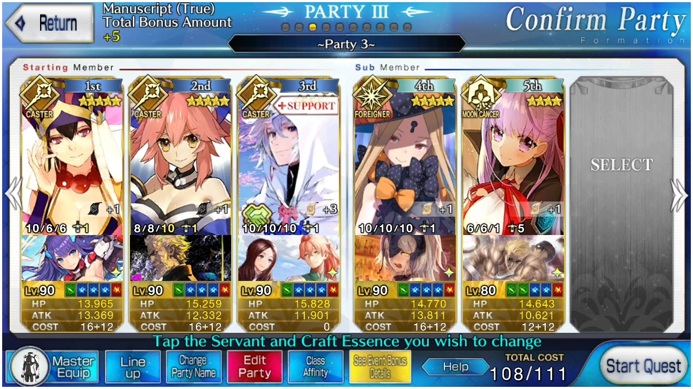
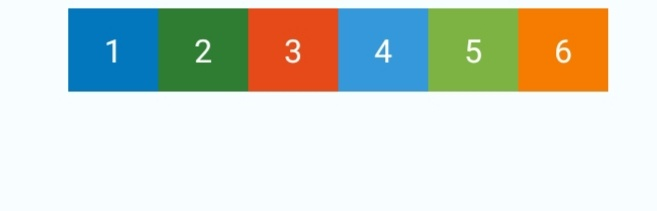

# Servant skills

The skills of the 3 Servants on the field are the letters `a` to `i`: `a b c` for the first Servant, `d e f` for the second and `g h i` for the third.

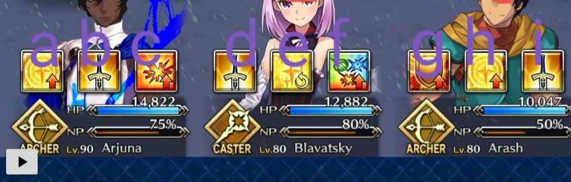
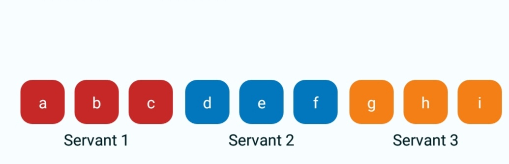

## Targeting

After tapping a skill, choose the Servant it targets, or **No Target** for skills that don't target anyone.
**Long-press** a skill to add it without a target, skipping the target screen.

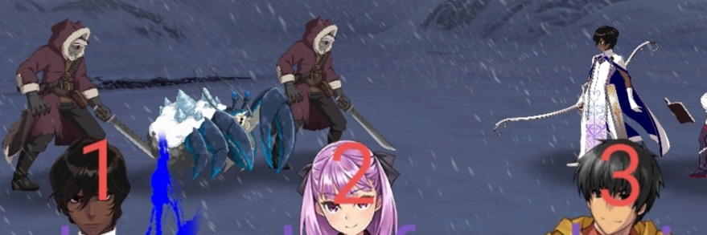
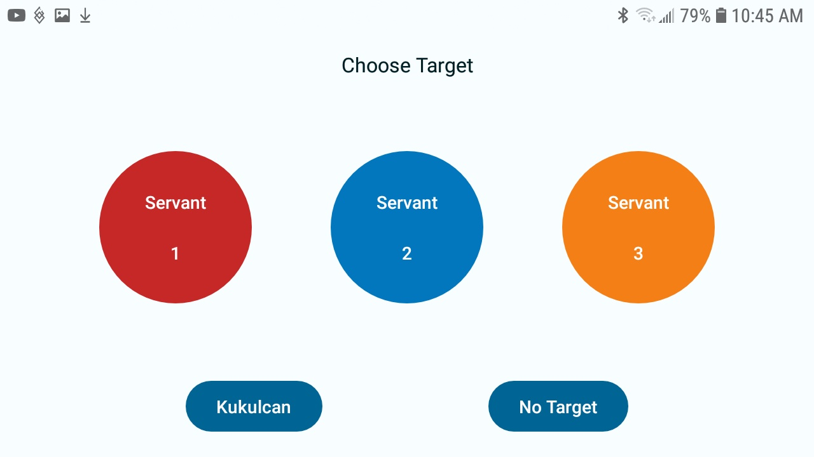

## Special skills

Some skills open an extra choice in FGO. The target screen shows buttons for them below the Servant buttons.
Each button has an ⓘ button that shows which Servants it is for.

| Button | Skills | Servants |
|---|---|---|
| [Choices (2)](#choices-2) | 1st, 2nd and 3rd | Kukulkan, UDK-Barghest, Dante Alighieri, Ryougi Shiki (Summer) |
| [Choices (3)](#choices-3) | 1st and 3rd | Van Gogh (Miner), Kishinami Hakuno, Shizuki Soujuurou, Charlotte Corday |
| [NP Type (2)](#np-type-2) | 3rd | Emiya, BB Dubai |
| [NP Type (3)](#np-type-3) | 2nd | Space Ishtar |
| [Transform](#transform) | 3rd | Mélusine, Ptolemaios |

On the choice screens, the Servant buttons at the bottom only change the labels of the option buttons, so you can see what each option does. They don't change the command.
The exception is the [2nd skill with Choices (2)](#choices-2-on-the-2nd-skill).

### Choices (2)

Pick `Option 1` or `Option 2`.

- **Kukulkan**, 1st and 3rd skill: Option 1 doesn't pay critical stars, Option 2 does.
- **UDK-Barghest**, 3rd skill: Option 1 keeps her NP AoE, Option 2 makes it Single Target.

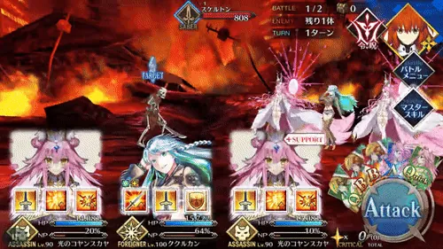

#### Choices (2) on the 2nd skill

Here you must first select the Servant. The options stay disabled until you do.

- **Kukulkan:** "Don't use stars" or "Use stars", then choose the Servant to target.
- **Dante Alighieri:** "Paradise (Arts Up)" or "Inferno (Buster Up)".
- **Summer Shiki:** "Moonlight (AOE)" or "Sun (ST)".

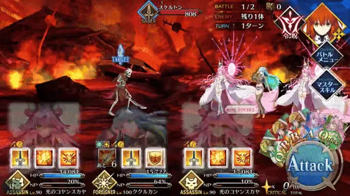

### Choices (3)

Pick one of 3 options.

- **Van Gogh (Miner)**, [1st skill](https://fategrandorder.fandom.com/wiki/Van_Gogh_(Miner)#First_Skill): Quick, Arts or Buster.
- **Kishinami Hakuno**, [3rd skill](https://fategrandorder.fandom.com/wiki/Kishinami_Hakuno_(Female)#Third_Skill): Sky, Earth or Man.
- **Shizuki Soujuurou**, [3rd skill](https://fategrandorder.fandom.com/wiki/Shizuki_S%C5%8Dj%C5%ABr%C5%8D#Third_Skill): Quick, Arts or Buster.
- **Charlotte Corday**, [upgraded 3rd skill](https://fategrandorder.fandom.com/wiki/Charlotte_Corday#Third_Skill): Arts, Crit Damage or NP Damage.

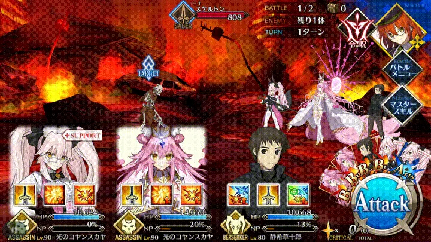

### NP Type (2)

Emiya and BB Dubai can change their NP type with their 3rd skill. Pick the left or right option.

Only use it for an Emiya whose 3rd skill is fully upgraded. FGA can't check that, but you can make sure with [Friends Only](Support-Selection#friends) when Emiya is your support.

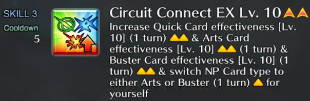
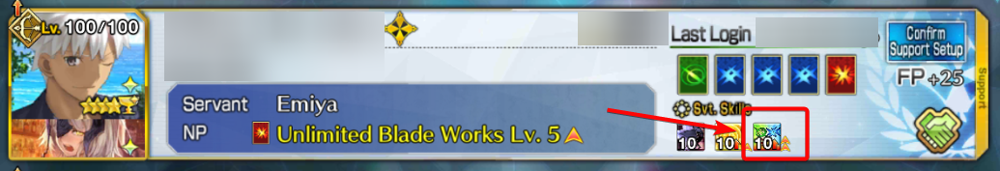

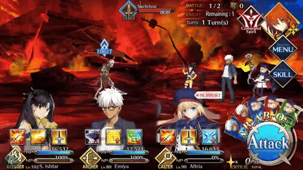

### NP Type (3)

Space Ishtar's [2nd skill](https://fategrandorder.fandom.com/wiki/Space_Ishtar#Second_Skill) changes her NP to Quick, Arts or Buster.

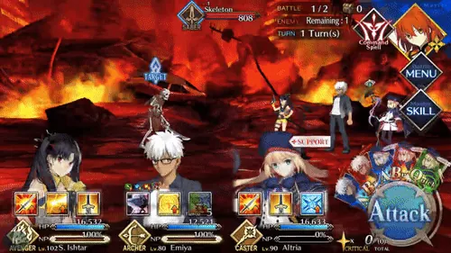

### Transform

Mélusine's [3rd skill at Ascension 1 and 2](https://fategrandorder.fandom.com/wiki/M%C3%A9lusine#Third_Skill) and Ptolemaios's [3rd skill](https://fategrandorder.fandom.com/wiki/Ptolemaios#Third_Skill) change the Servant's form during the battle.
`Transform` waits for the long animation and makes FGA recognize the new face cards. Without it, [Servant Priority](Card-Priority#servant-priority) breaks for the rest of the battle.

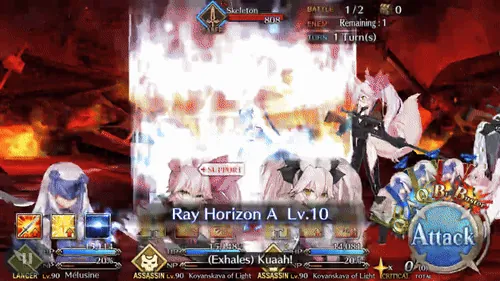

- **Mélusine** only transforms once. Use the normal 3rd skill for every later use, for example `c` when she is in the 1st position. If she starts the battle in Ascension 3, don't use `Transform` at all.
- **Ptolemaios** transforms on every use, so always use `Transform`.

# Enemy targeting

Enemies are numbered too. Selecting an enemy adds a target change to the command. Like in FGO, only one enemy can be targeted at a time.

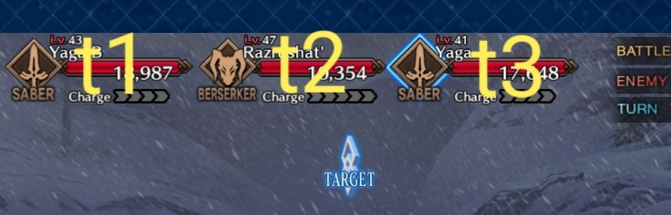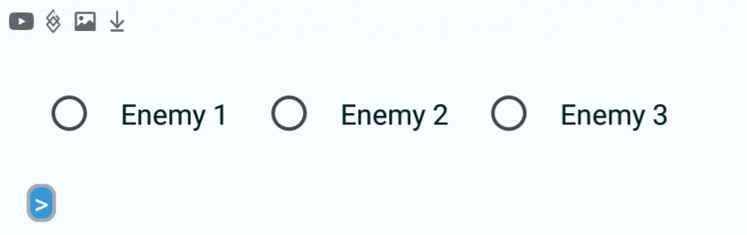

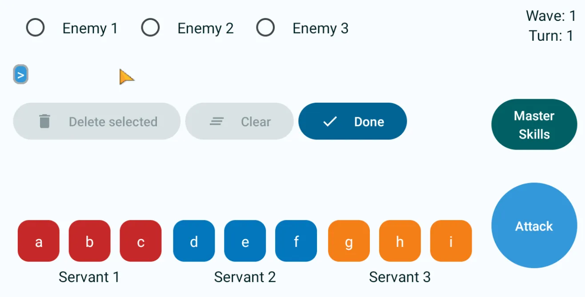

# Noble Phantasms

Tap **Attack**, then the Servants whose NPs to use. They're used in the order you tap them.

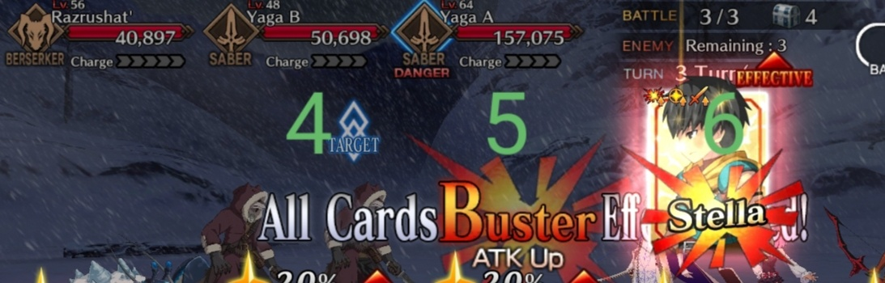
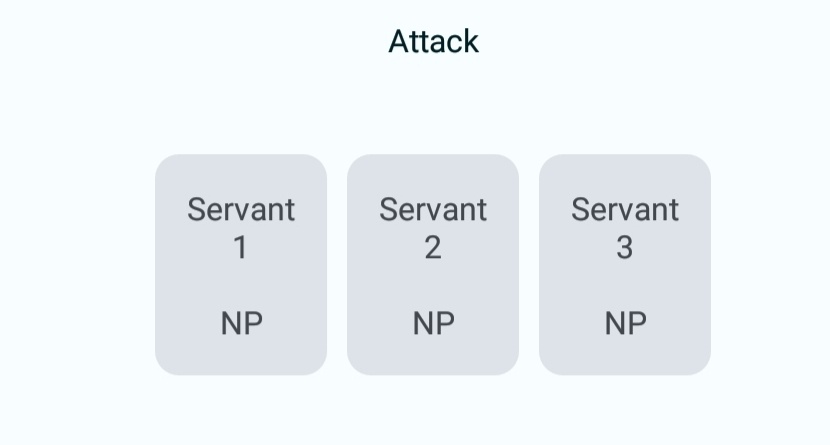

**Cards before NP** plays 1 or 2 face cards before the NPs.

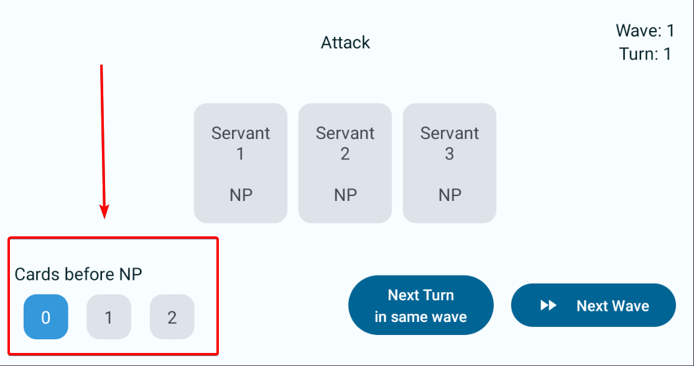

The remaining face cards are picked by [Card Priority](Card-Priority).

# Master skills

Master skills work the same for every Mystic Code: `j`, `k` and `l`. Like Servant skills, long-press one to add it without a target.

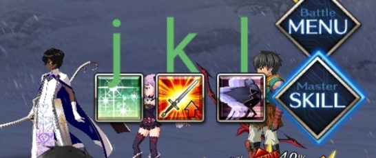

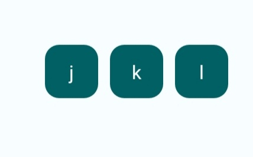

## Order Change

For Mystic Codes whose 3rd skill is Order Change, such as the Plugsuit or the Chaldea Combat Uniform, use **Order Change / Plug-suit** instead of `l`.
Pick the Starting Member to swap out and the Sub Member to swap in.

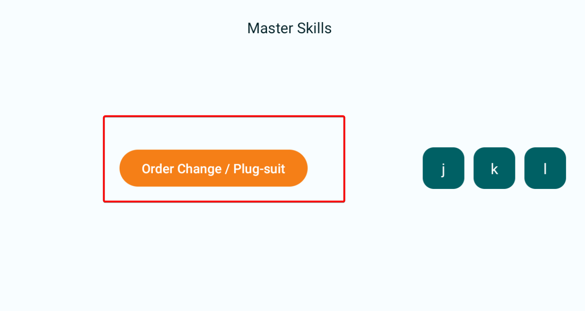

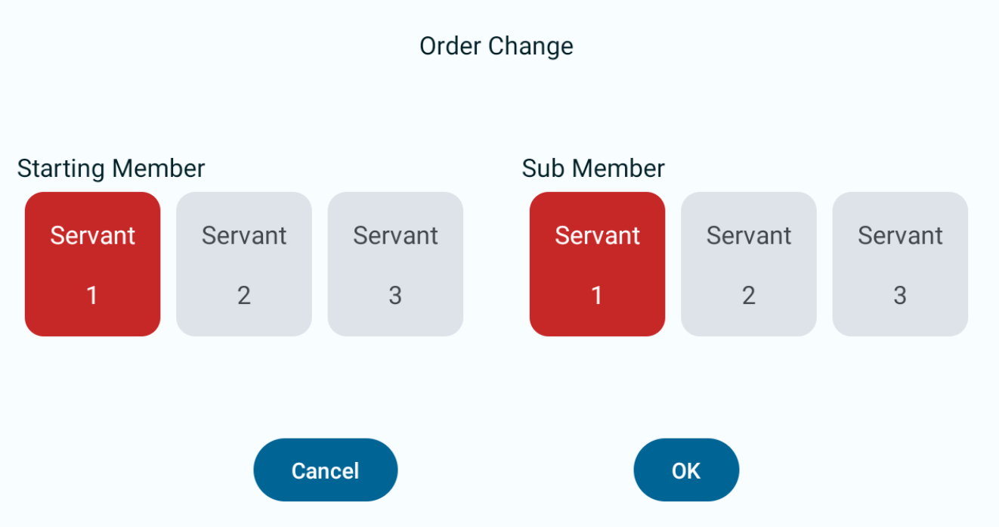

# Command Spells

The `CS` button adds a Command Spell that fully charges one Servant's NP gauge. It asks which Servant to charge.
Only the NP charge is supported, not the HP restore.

The number on the button is how many Command Spells the command can still use. You can hold at most three, so a config can use at most three. Deleting a Command Spell entry gives one back.

FGA can't read how many Command Spells your account has. If there are none left when the script gets there, it stops with "Ran out of Command Spell(s)".

# Waves and turns

After the skills and NPs of a turn, tap Attack and choose how to continue:

- **Next Wave:** wait for the next wave. The wave counter is in the top right in FGO.

  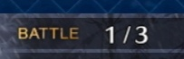

  Everything you add afterwards is only used in the next wave, so check your command for mistakes.

  

- **Next Turn in same wave:** for waves that take more than one turn.

  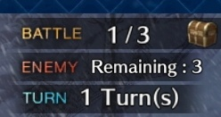

  

The Command Editor shows the current wave and turn.

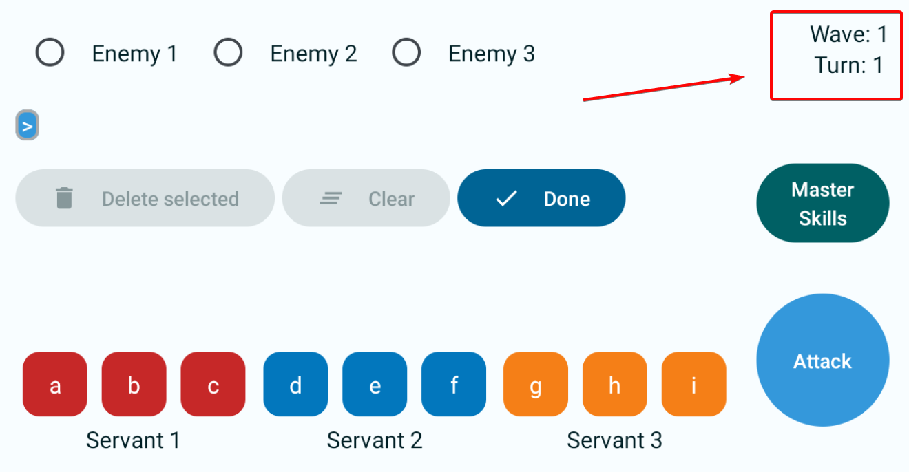

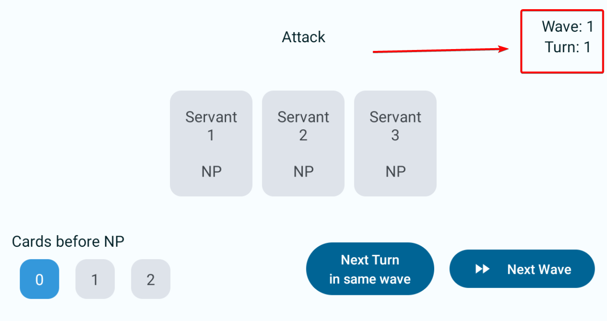

## Raid battles

Raid battles often have only 1 wave, so use **Next Turn in same wave** instead of Next Wave.

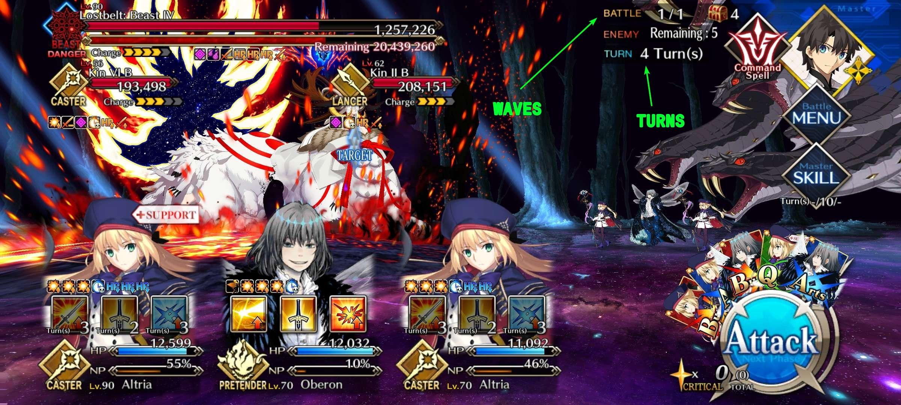

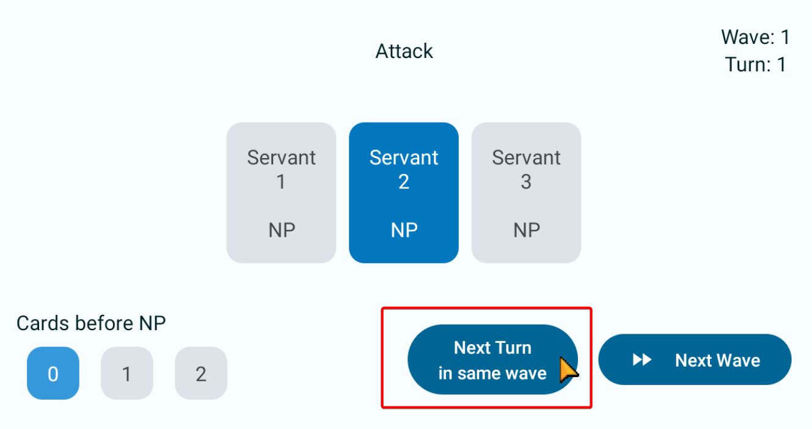

Also turn on the [Raid Turn Delay](Battle#raid).

# Editing a command

- Tap an entry in the history to insert new actions after it.
- **Delete selected** removes the selected entry, **Clear** removes everything.
- **Done** saves the command.

# Command text format

You can also type a command as text in the battle config. This is the format the Command Editor produces:

| Text | Meaning |
|---|---|
| `a` to `i` | Servant skills |
| `j`, `k`, `l` | Master skills |
| `1`, `2`, `3` after a skill | Target Servant, e.g. `b1` |
| `4`, `5`, `6` | NPs of the Servants on the field |
| `t1`, `t2`, `t3` | Target an enemy |
| `n1`, `n2` | Cards before NP |
| `x12` | Order Change: swap Starting Member 1 with Sub Member 2 |
| `o1`, `o2`, `o3` | Command Spell: charge a Servant's NP |
| `0` | Do nothing this turn |
| `,` | Next turn in the same wave |
| `,#,` | Next wave |

Special skills use these targets after the skill: `7` and `8` for [NP Type (2)](#np-type-2), `M` for [Transform](#transform), `[Ch2A]` and `[Ch2B]` for [Choices (2)](#choices-2), `[Ch3A]` to `[Ch3C]` for [Choices (3)](#choices-3).
Several targets in a row go in brackets, e.g. `b([Ch2A]1)` for Kukulkan's 2nd skill without stars on Servant 1.
