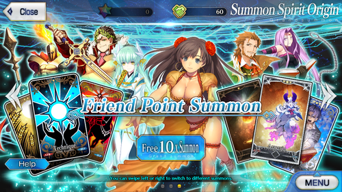
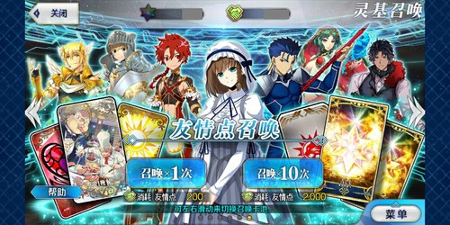
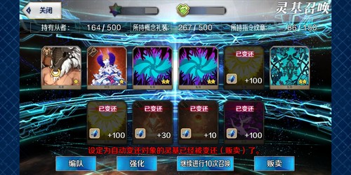

Rolls Friend Point summons until your inventory is full or the roll limit is reached.

## Starting

Press PLAY on the Friend Point summon screen. FGA also does the daily free summon if it's available:

You can also start from the summon results screen:

As a safeguard, the script isn't offered on the Saint Quartz summon screen.

## Options

**Limit number of rolls:** stop after this many rolls.

## When it stops

- **Inventory Full:** FGO says your inventory is full. This is only detected on NA, JP and KR. On CN and TW, use the roll limit.
- **Rolled X time(s):** the roll limit was reached.
