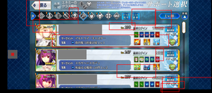
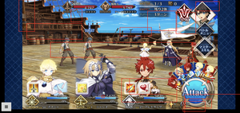

## How FGO should look

FGO should fill the entire screen, including the notch area. There should be no black bars.

## Game Area Mode

`More options` → `Advanced` → `Game Area Mode` tells FGA where the game is on the screen:

- **Default:** the game fills the whole screen. Use this whenever possible.
- **Surface Duo:** for the Microsoft Surface Duo.
- **Custom:** for screens where the game doesn't fill the screen and the fixes below don't help. Enter the width of the black borders in pixels for Left, Right, Top and Bottom. The [Custom Game Area megathread](https://github.com/Fate-Grand-Automata/FGA/issues/1347) has values for some devices.

## FGO looks different on my phone

### CASE 1: Borders around FGO are black

On some devices, FGO isn't covering the full screen. This could be because of system settings or because of Android 12 Gesture Navigation.

This is an example which causes problems for FGA:  

If your device is made by Huawei, LG, Samsung or Xiaomi, you can fix the black bars with System Settings.

Fullscreen settings per manufacturer:
<table>
  <tr>
    <th>Manufacturer</th>
    <th>Guide</th>
  </tr>
  <tr>
    <td>Huawei</td>
    <td>
      <ul>
        <li>Open <em>Settings</em> app</li>
        <li>Go to <em>Display & brightness > More display settings > Full-Screen Display</em></li>
        <li>Turn ON the switch for FGO</li>
      </ul>
    </td>
  </tr>
  <tr>
    <td>LG</td>
    <td>
      <ul>
        <li>Open <em>Settings</em> app</li>
        <li>Go to <em>Display > App scaling</em></li>
        <li>Set FGO to Full Screen</li>
      </ul>
    </td>
  </tr>
  <tr>
    <td>Samsung</td>
    <td>
      <ul>
        <li>Open <em>Settings</em> app</li>
        <li>Search for and select <em>Full screen apps</em></li>
        <li>Turn ON the switch for FGO</li>
      </ul>
    </td>
  </tr>
  <tr>
    <td>Xiaomi</td>
    <td>
      <ul>
        <li>Open <em>Settings</em> app</li>
        <li>Go to <em>Display > Fullscreen mode</em></li>
        <li>Turn ON the switch for FGO</li>
      </ul>
    </td>
  </tr>
</table>

If you have any other device, try switching to 3-Button Navigation (Triangle, Circle, Square). If that doesn't work, or you want to keep using gesture navigation, use the [Custom Game Area Mode](#game-area-mode).

### CASE 2: Your phone has borders around FGO even at the bottom of screen

| LG V60 | Google Pixel 4L |
|---|---|
|  |  |

The black borders are for gesture navigation.

To get rid of them:
- Go to `Settings > System > Gestures > System Navigation`.
- Change to `3-button navigation`.

If that doesn't work, use the [Custom Game Area Mode](#game-area-mode).
