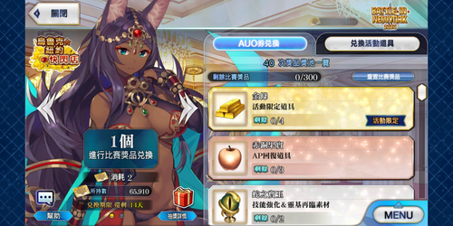
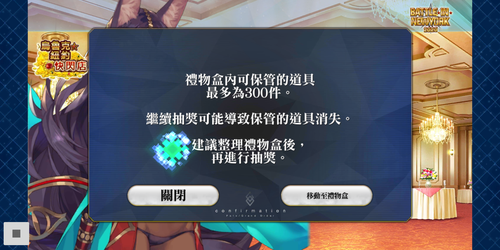

Spins the event lottery until the currency runs out or the Present Box is full.

> **Warning:** Avoid the Lottery script on boxes 1-10. If you don't have enough currency, it can reset the box right after you get the Grand Prize.

## Starting

Press PLAY on the event lottery screen.

## Options

**Receive embers:** when the Present Box is full, open it and receive EXP cards with the [Gift Box](Gift-Box) script.
Its two options appear below the switch.
The script ends after receiving the embers, so press PLAY on the lottery screen again to continue.

## When it stops

- **Ran out of lottery currency**
- **Present Box Full:** only when **Receive embers** is off.

## Template images

Lottery screens change with every event. FGA needs two images per server to recognize them. If the script doesn't start or doesn't stop correctly, these may need updating:

1. `lottery.png`

   

2. `StopGifts.png`

   
