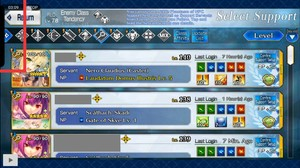

- [First steps](#first-steps)
- [Make sure the game looks the way FGA expects](#make-sure-the-game-looks-the-way-fga-expects)
- [PLAY button](#play-button)
- [Scripts](#scripts)
- [Battle](#battle)
- [Recording and screen recorders](#recording-and-screen-recorders)
- [Other questions](#other-questions)

# First steps

Force-stop FGA or restart your phone and see if that fixes it. This is a quick fix for battery optimization issues.

If FGA worked before and doesn't now, or keeps asking for Accessibility even though it's ON, see [#314](https://github.com/Fate-Grand-Automata/FGA/issues/314).

Having trouble on an emulator? See [Running on Emulators](Running-on-Emulators).

# Make sure the game looks the way FGA expects

Most problems come from FGO not filling the screen the way FGA expects, for example black borders around the game.
See [Game Area detection](Game-Area-detection).

Also check that nothing covers the game, like overlays from other apps:

# PLAY button

## Where's the PLAY button?

The PLAY button only appears when your phone is in landscape, for example when you open FGO. If it still doesn't appear, try stopping and starting the Accessibility Service, and force-closing FGA, until it appears.

If the button disappears overnight or when you lock your screen, battery optimization is at fault. See [#314](https://github.com/Fate-Grand-Automata/FGA/issues/314).

## Where should I place the PLAY button?

The bottom-left corner is ideal. In other places it may cover something FGA needs to see.

## The PLAY button is in the way when I watch videos

In the FGA notification, press the arrow in the top right, then Stop.
To get the PLAY button back, open FGA and start the service again.

## Pressing PLAY doesn't open the dialog

A game booster, game mode, or a similar feature is blocking popups while FGO runs. Turn it OFF. This is known to happen on some LG, Samsung and Motorola phones.

On LG, turn OFF [Game Tools](https://www.lg.com/us/support/help-library/lg-g7-thinq-gaming-tools-CT10000027-20150726480680), which can block alerts.
On other phones, look for something like a Game Booster in your settings.

## "FGA couldn't detect which FGO server is running"

Leave FGO, open it again and retry.
If your FGO version isn't recognized, or it runs inside an app cloner, select your server in `More options` → `Battle` → `Game Server`.

# Scripts

## I can't press OK in the Battle dialog

Select a battle config on the left. If the list is empty, create one first, see [Battle](Battle#battle-configs).
The list only shows configs for the current game server, plus configs without a server.

## The wrong script is offered

FGA picks the script from the screen you're on. Check the table in [Getting Started](Getting-Started#run-a-script) for the screen each script needs.

## Support images are missing or not found

Extract the default images again with `More options` → `Storage` → `Extract Default Support Images`. For other Servants and CEs, create images with the [Support Image Maker](Support-Image-Maker).

# Battle

## FGA doesn't pick NPs or cards, or gets stuck on an info screen

If your phone lags badly, increase the delays in [Fine-tune](Fine-tune), for example **Wait before Cards** or **Wait Multiplier**.

## Skills are used in the wrong wave

Try changing **Stage Counter Similarity** in [Fine-tune](Fine-tune#similarity), or turn on `Thresholded stage counter detection` in [More Options](More-Options#advanced).

## Why does FGA open the Servant details at the start of a battle?

That's intended. FGA takes a picture of each Servant's face so it knows which face cards belong to whom.
It does this every time a new Servant enters the field.

You can turn it off with `More options` → `Battle` → `Skip servant face-card checks`, but then Brave Chains, Servant Priority and Shuffle cards don't work.

## Where did "Stop after CE drop" go?

It's the **CEs** limit in the dialog after pressing PLAY. See [Limits](Battle#limits).

# Recording and screen recorders

Don't use other screen recorders together with FGA. If you do and FGA stops working properly, force-stop FGA.

For bug reports, use FGA's own recorder: `More options` → `Advanced` → `Record Screen`.
It isn't available on Android 13 and later, or with root screenshots. See [this video](https://youtu.be/iIjZPjDcZeM) for recording on Android 13 and later without root.

# Other questions

## Do I need root?

No. Some emulators need root to work. If your phone is rooted, enabling `Use Root for Screenshots` can avoid some issues.

## Can I run FGA on Apple devices?

No, the app is Android-only. There are auto-clickers for Apple devices, but they don't have the intelligence of FGA.
You can run FGA on an [emulator](Running-on-Emulators) instead.

Video guide for creating auto-clicker rules with voice control: https://www.youtube.com/watch?v=JSFiys-j0JM

## Will I get banned for using FGA?

FGO's Terms of Service contain this line, so anything could be banworthy to them:
(17) Any other act which Aniplex considers inappropriate.

However, nobody has been banned for using third-party apps so far. Bans mainly happen for account trading.

## Can FGA do story quests?

No, because:
- FGO requires you to find and select the next story node on the map, which needs complicated swiping and tapping.
- From Camelot on, story chapters can't be beaten consistently with the same teams. You need to look up enemy patterns and build specific teams.
- The SKIP button in the top right can't be detected reliably, so FGA gets stuck at dialogue choices.
